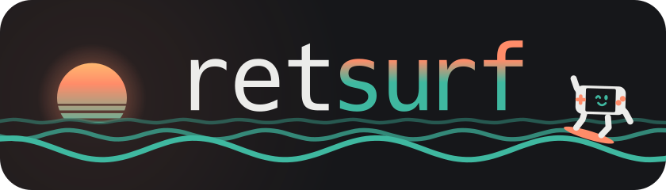
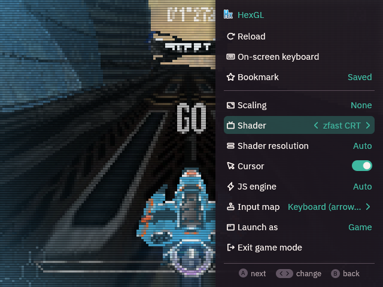
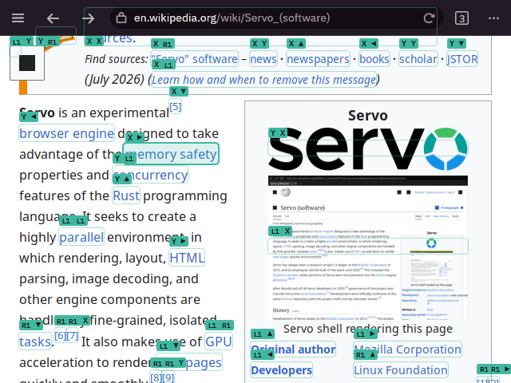
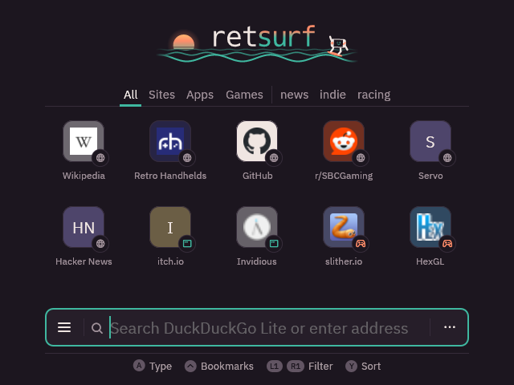
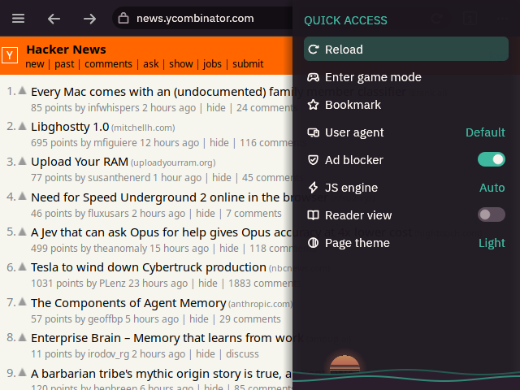

  

  
  
  
  <!-- The check workflow, not a platform build: it is the one a push and a pull request run, and it carries the tests and clippy. -->
  

  <a href="https://retsurf.app/">Website</a> &middot;
  <a href="#install">Install</a> &middot;
  <a href="docs/CONFIGURATION.md">Docs</a> &middot;
  <a href="https://github.com/mxmgorin/retsurf/discussions">Discussions</a>

retsurf is a console-like web browser built on [Servo](https://servo.org/), an independent web engine written in Rust. It is designed for gamepads and keyboards, with touch support, a virtual cursor and Vimium-style link hints, and launches sites as apps and games from Home. It also offers fullscreen mode, remappable controls, scaling and shaders for games. It runs on retro handhelds down to a 128 MB Miyoo Mini with no GPU, on Kindles, phones and desktops; see **[supported platforms](#install)**.

> **Work in progress.** Early development — expect bugs. See [Limitations](#limitations).

## Screenshots

<table>
  <tr>
    <td width="50%"></td>
    <td width="50%"></td>
  </tr>
  <tr>
    <td width="50%"></td>
    <td width="50%"></td>
  </tr>
</table>

More screenshots and device photos are on the [website](https://retsurf.app/).

## Goals

- **Bring the web to any device.** Provide a full browser on hardware that lacks a modern one, like retro handhelds.
- **Run web games anywhere.** Run websites and local game folders in fullscreen, with dedicated controls and no browser UI.
- **Help improve Servo.** Find and fix engine bugs on real devices, contributing those fixes upstream.

## Features

- **Console-like interface** 
  Navigate the entire browser with a gamepad or keyboard. Use a virtual cursor, Vimium-style link hints, and an on-screen keyboard with grid and wheel layouts. Rebind browser actions with support for taps, holds, and button combinations.

- **Home as a launcher** 
  Open each bookmark as a site, as an app without browser UI, or as a game in Game Mode. Filter by sites, apps, games, or tags; sort manually, by name, or by last opened; switch between grid and list layouts. Keep per-bookmark settings such as user agent, dark mode, and Game Mode.

- **Broad device support** 
  Runs on devices ranging from 128 MB handhelds to desktops and e-ink Kindles. Uses SDL2's available video backend, without requiring X11 or Wayland. Renders through OpenGL ES or entirely on the CPU.

- **Game Mode** 
  Hide the browser UI and route input directly to the page. Remap buttons and sticks to keys, mouse, or raw gamepad input using the in-app editor. Launch games without browser UI using `--kiosk` ([Command line](docs/CLI.md)).

- **Scaling and shaders** 
  Extract game content from its page and fit it to the screen using integer scaling or stretching. Apply CRT, LCD, and upscaling shaders, including RetroArch's single-pass GLSL shaders. Includes ten built-in shaders. See [Shaders](docs/SHADERS.md).

- **Tabs, bookmarks, history, and downloads** 
  Manage browsing sessions through the full-screen Hub. Download files in the background with progress tracking and cancellation.

- **Real page zoom** 
  Reflow page layouts instead of simply magnifying them. Adjust zoom from 50% to 300%, independently for each tab.

- **Reader view** 
  Strip pages down to their articles using Mozilla's [Readability](https://github.com/mozilla/readability). Apply it in place, including to logged-in and dynamically rendered pages.

- **Dark mode** 
  Respect sites' own dark themes through `prefers-color-scheme`, or force a dark appearance on pages without one.

- **Ad and tracker blocking** 
  Block network requests using Brave's [`adblock-rust`](https://github.com/brave/adblock-rust), with EasyList and EasyPrivacy filters.

- **Media playback** 
  Play audio and video through a custom Servo media backend, including direct media files and embedded players.

- **In-app updates** 
  Check GitHub for updates, view release notes, and install updates in place on Linux. Choose between stable, beta, and nightly channels.

- **No telemetry** 
  Avoid telemetry and unnecessary background requests. Automatically check for updates and refresh ad-block lists; both can be disabled in Settings.

## Limitations

| Area | Limitation |
| --- | --- |
| Site compatibility | Servo does not support every web feature yet: some sites render incorrectly or break. |
| Streaming video | No Media Source Extensions: YouTube, Twitch and similar players do not play. |
| Media formats | Video: H.264 in MP4 only, no WebM, VP9, AV1 or HEVC. Audio: MP3, AAC, FLAC, Vorbis and WAV, no Opus. |
| DRM | No Encrypted Media Extensions: Netflix, Spotify and other DRM services do not play. |
| Video calls | No WebRTC. |
| Extensions | Browser extensions are not supported. |
| Low-end devices | Heavy sites load slowly and can run out of memory on 128 MB devices. |
| Security | All sites run in one process, with no site isolation. |

## Install

retsurf runs on the platforms below; download the package for yours. All builds are available on
[Releases](https://github.com/mxmgorin/retsurf/releases). Nightly builds from `main` use
the same file names under the rolling
[`nightly`](https://github.com/mxmgorin/retsurf/releases/tag/nightly) tag.

| Platform | Package | Where it goes |
| --- | --- | --- |
| [PortMaster](https://portmaster.games/supported-devices.html) | [`retsurf-portmaster.zip`](https://github.com/mxmgorin/retsurf/releases/latest/download/retsurf-portmaster.zip) | ports folder, e.g. `/roms/ports/` |
| [OnionOS](https://onionui.github.io/) | [`retsurf-onionos.zip`](https://github.com/mxmgorin/retsurf/releases/latest/download/retsurf-onionos.zip) | `App/Retsurf/` on the SD card |
| [Allium](https://github.com/goweiwen/Allium) | [`retsurf-allium.zip`](https://github.com/mxmgorin/retsurf/releases/latest/download/retsurf-allium.zip) | `Apps/Retsurf.pak/` on the SD card |
| [spruceOS](https://github.com/spruceUI/spruceOS) | [`retsurf-spruceos-aarch64.zip`](https://github.com/mxmgorin/retsurf/releases/latest/download/retsurf-spruceos-aarch64.zip), [`retsurf-spruceos-armhf.zip`](https://github.com/mxmgorin/retsurf/releases/latest/download/retsurf-spruceos-armhf.zip) (Miyoo Mini) | root of the SD card |
| [NextUI](https://github.com/LoveRetro/NextUI), [NX Redux](https://github.com/mohammadsyuhada/nx-redux) | [`retsurf-nextui.zip`](https://github.com/mxmgorin/retsurf/releases/latest/download/retsurf-nextui.zip) | root of the SD card, lands in `Tools/` |
| [CrossMix-OS](https://github.com/cizia64/CrossMix-OS) | [`retsurf-crossmix.zip`](https://github.com/mxmgorin/retsurf/releases/latest/download/retsurf-crossmix.zip) | root of the SD card |
| Kindle (jailbroken) | [`retsurf-kindle.zip`](https://github.com/mxmgorin/retsurf/releases/latest/download/retsurf-kindle.zip) | root of the Kindle's USB storage |
| Android | [`retsurf-android-arm64.apk`](https://github.com/mxmgorin/retsurf/releases/latest/download/retsurf-android-arm64.apk) | sideload it |
| Linux | [`retsurf-linux-x86_64.zip`](https://github.com/mxmgorin/retsurf/releases/latest/download/retsurf-linux-x86_64.zip), [`retsurf-linux-aarch64.zip`](https://github.com/mxmgorin/retsurf/releases/latest/download/retsurf-linux-aarch64.zip) | unpack and run |
| Windows | [`retsurf-windows-x86_64.zip`](https://github.com/mxmgorin/retsurf/releases/latest/download/retsurf-windows-x86_64.zip) | unpack and run |
| macOS | [`retsurf-macos-aarch64.dmg`](https://github.com/mxmgorin/retsurf/releases/latest/download/retsurf-macos-aarch64.dmg) | open it and run `Retsurf.app` |

On the Miyoo Mini firmwares, spruceOS included, the app shows up in the Apps menu, and **MENU quits** it. On spruceOS's aarch64 handhelds and CrossMix-OS it is under Apps too, and **Select + Start** quits it.

On Kindle, start it from KUAL (**Retsurf > Start Retsurf**) or from KOReader (**Tools > Retsurf browser**), and quit with **Quit retsurf** in the menu at the top left; it returns to where it was started.

Devices people have run it on are collected in [Tested devices](https://github.com/mxmgorin/retsurf/discussions/78).

## Building

`cargo run`, once Servo's build dependencies are installed. See **[Building from
source](docs/BUILDING.md)** for the prerequisites on each OS, the Cargo features,
Android, and the handheld cross-builds.

## Configuration

Files are stored in the user data directory (`SDL_GetPrefPath`, e.g. `~/.local/share/mxmgorin/retsurf/` on Linux).
Templates with the defaults are written on first run. See **[Configuration](docs/CONFIGURATION.md)** for all options, **[Controls](docs/CONTROLS.md)** for bindings and Game Mode input maps, **[Command line](docs/CLI.md)** for arguments and environment variables, **[Shaders](docs/SHADERS.md)** for Game Mode shaders, and **[Glossary](docs/GLOSSARY.md)** for the names of screens and controls.

## How to help

If you find the project useful, here is how you can help:

- **Tell other people about it.** Sharing the project helps it reach more users.
- **Report bugs and request features** in [Issues](https://github.com/mxmgorin/retsurf/issues). Feedback is welcome.
- **Star the repo.** It helps the project get noticed and keeps me motivated.
- **[Buy me a coffee](https://ko-fi.com/mxmgorin)** on Ko-fi.

## Credits

- Web rendering by [Servo](https://servo.org)
- [SDL2](https://libsdl.org) through [rust-sdl2](https://github.com/Rust-SDL2/rust-sdl2)
  for window, input and audio
- [egui](https://github.com/emilk/egui) draws every overlay, with icons from
  [Phosphor](https://phosphoricons.com/) and text in [IBM Plex Sans](https://github.com/IBM/plex)
- Blocking by Brave's [adblock-rust](https://github.com/brave/adblock-rust), over
  [EasyList](https://easylist.to/) and EasyPrivacy
- Reader view by Mozilla's [Readability](https://github.com/mozilla/readability)
- Media by [Symphonia](https://github.com/pdeljanov/Symphonia) and
  [openh264](https://github.com/ralfbiedert/openh264-rs) over Cisco's codec
- TLS by [rustls](https://github.com/rustls/rustls)
- SDL2 for the Miyoo Mini by [Steward Fu](https://github.com/steward-fu/sdl2)
- Game Mode shaders from libretro's [glsl-shaders](https://github.com/libretro/glsl-shaders):
  zfast_crt by Greg Hogan, crt-pi by davej, crt-lottes by Timothy Lottes, xBR by Hyllian
  and sharp-bilinear by rsn8887; OmniScale and the LCD shaders from
  [SameBoy](https://github.com/LIJI32/SameBoy) by Lior Halphon

## License

Copyright (C) 2025-2026 Maxim Gorin. retsurf is free software under the
[GNU General Public License v3.0 or later](LICENSE), with the additional terms in
[NOTICE](NOTICE). The name, logo and icons: [TRADEMARKS.md](TRADEMARKS.md).
